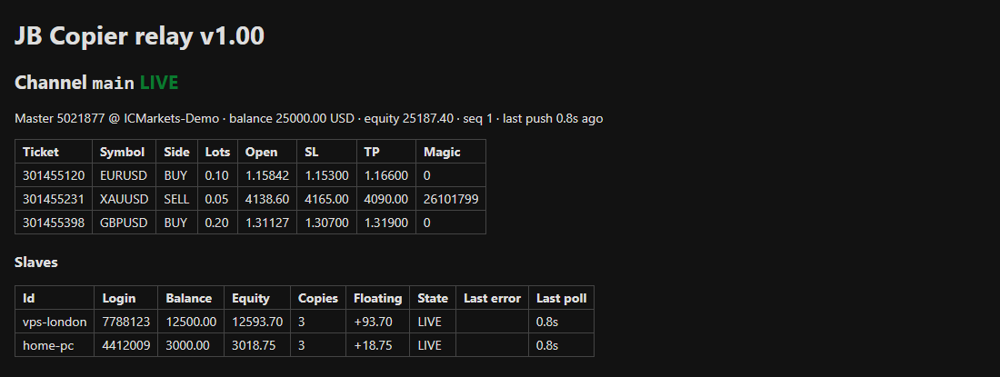

# JB Copier: remote trade copier for MetaTrader 5

**Mirror one MT5 account's trades onto any number of other MT5 accounts, across PCs, VPSes and brokers, through a tiny self-hosted relay.**

[](LICENSE)
[](server/copy_server.py)
[](requirements.txt)
[](mql5/)
[](https://github.com/Anoopkumarchaudhari/copy_trading_MT5/stargazers)

One **master** MT5 account publishes its open positions to a small relay server.
Any number of **slave** MT5 accounts pull that book and mirror it with their own lot sizing.
The relay is a single Python file with no pip dependencies. The EAs are plain MQL5.



*The relay's built-in dashboard: master book, every slave's balance, equity, copies and state.*

## Why JB Copier

- **Works across brokers and machines.** Master and slaves only need HTTP(S) access to the relay. Symbol mapping and suffix handling (`GOLD=XAUUSD`, strip `.fx`, add `.m`) are built in.
- **Self-healing.** Slaves reconcile against whole snapshots instead of replaying events. A slave that restarts, drops its connection or misses an update fixes itself on the next answer.
- **Fails safe.** If the master goes silent the slaves **freeze**: nothing opens, nothing closes. An empty book from a reconnecting terminal is never pushed.
- **Flexible sizing.** Fixed lots, multiplier, balance ratio or equity ratio, with a per-copy cap and contract-size adjustment.
- **Risk guards.** Max signal age, max price deviation, max open copies, daily loss limit, symbol and magic filters.
- **Reverse copying.** Copy BUY as SELL and SELL as BUY, with SL and TP swapping roles.
- **Zero-dependency relay.** Python standard library only. Runs on a $5 VPS, Windows or Linux, with an HTML dashboard and a JSON state endpoint.
- **Tested.** Scripted Strategy Tester runs and a live demo harness are in [`test/`](test/), with logs.

## How it fits together

```
 MT5 master terminal                 relay server (VPS)                 MT5 slave terminals
┌───────────────────┐  POST push   ┌──────────────────────┐  GET pull  ┌───────────────────┐
│ JB_CopyMaster EA  │ ───────────► │ copy_server.py       │ ◄───────── │ JB_CopySlave EA   │
│ snapshot of all   │  on change + │ keeps latest book    │ long-poll  │ reconcile own     │
│ open positions    │  every 2 s   │ per channel, keys,   │ (wakes on  │ positions vs book │
└───────────────────┘              │ dashboard            │  change)   └───────────────────┘
                                   └──────────────────────┘
```

| Path | What it is |
|---|---|
| [`server/copy_server.py`](server/copy_server.py) | Relay server. Python 3.8+ standard library only. |
| [`server/copy_server.example.json`](server/copy_server.example.json) | Shape of the config. The real `copy_server.json` is generated on first run and is git-ignored. |
| [`server/VPS_SETUP.md`](server/VPS_SETUP.md) | Step-by-step VPS guide for Windows (Task Scheduler) and Linux (systemd). |
| [`server/jb-copier.service`](server/jb-copier.service) | Hardened systemd unit for the relay. |
| [`mql5/JB_CopyMaster.mq5`](mql5/JB_CopyMaster.mq5) | Master EA. Publishes positions and never trades. |
| [`mql5/JB_CopySlave.mq5`](mql5/JB_CopySlave.mq5) | Slave EA. Opens, closes and modifies copies. Default magic `26101701`. |
| [`mql5/JB_CopierNet.mqh`](mql5/JB_CopierNet.mqh) | HTTP transport shared by both EAs (WebRequest or WinINet). |
| [`mql5/*.ex5`](mql5/) | Compiled EAs, so you can attach them without MetaEditor. |
| [`test/`](test/) | Scripted master, Strategy Tester runner, live demo runner, deal analyzer, results. |

## Quick start

You need: one always-on machine for the relay (a VPS or any PC), Python 3.8+, and MT5 terminals for the master and each slave. The slave accounts must be **hedging** accounts.

### 1. Start the relay

```bash
git clone https://github.com/Anoopkumarchaudhari/copy_trading_MT5.git
cd copy_trading_MT5/server
python copy_server.py --host 0.0.0.0 --port 8787
```

The first run writes `copy_server.json` with fresh random keys and prints them:
one `master_key` per channel, one or more `slave_keys`, and one `admin_key` for the dashboard.
Open TCP port 8787 in the firewall. Full VPS instructions, including auto-start and HTTPS,
are in [`server/VPS_SETUP.md`](server/VPS_SETUP.md).

- Dashboard: `http://<server>:8787/?key=<admin_key>` (refreshes every 2 s)
- JSON state for scripts: `GET /v1/main/state?key=<admin_key>`
- Health check: `GET /health`
- Log file: `copy_server.log`, next to the config

Over the internet, use HTTPS: `--cert fullchain.pem --key privkey.pem` with a real certificate
(for example from Let's Encrypt), or put Caddy or nginx in front. WebRequest rejects self-signed certificates.

### 2. Allow the URL in every terminal

Copy the `mql5/` files into your terminal's `MQL5\Experts\` folder (or just the `.ex5` files).

In MT5, open Tools → Options → Expert Advisors, tick "Allow WebRequest for listed URL"
and add `http://<server>:8787`. Use the exact scheme, host and port the EA uses.

MT5 encrypts this list in `config\common.ini`. A startup `/config` file **cannot** set it;
it only wipes the list. On a terminal where nobody can open that dialog, such as a headless
VPS clone, use `InpTransport = WinINet` instead. That transport needs "Allow DLL imports"
but no URL list, and it keeps the connection open between requests.

### 3. Attach the master EA

Attach `JB_CopyMaster` to any one chart on the master account and set:

- `InpServerUrl` and `InpChannel`
- `InpMasterKey`
- `InpMagicInclude` (optional): publish only these EA magics, `0` = manual trades. Empty = everything.
- `InpMagicExclude`: magics never to publish. If a slave runs on the same account, put its magic here.
- `InpSymbols` (optional): publish only these symbols.

The chart comment shows LIVE or the error, the number of positions published,
the sequence number and the age of the last push.

### 4. Attach the slave EA

Attach `JB_CopySlave` to any one chart on each follower account.

| Input | Meaning |
|---|---|
| `InpSlaveKey`, `InpSlaveId` | Key from the config; name shown on the dashboard |
| `InpLotMode` | `Fixed`, `Multiplier`, `BalanceRatio` (default) or `EquityRatio`; `InpLotValue` is the lot or the multiplier |
| `InpMaxLot`, `InpRoundUpToMin` | Cap per copy; what to do below the broker minimum |
| `InpAdjustContract` | Scales lots when contract sizes differ (gold 100 oz vs 1 oz) |
| `InpSymbolMap`, `InpMasterSuffix`, `InpSlaveSuffix` | `GOLD=XAUUSD`, strip `.fx`, add `.m` |
| `InpSymbolsAllow`, `InpMagicAllow` | Copy only some symbols or master strategies |
| `InpCopyExisting` | Also copy positions already open when the slave starts. Off by default. |
| `InpMaxSignalAgeSec` | Don't open copies of master trades older than this. Default 60 s. |
| `InpMaxDeviationPts` | Skip the entry if the price moved this many points **against** the slave. Default 50; raise it for gold or indices. |
| `InpCopySLTP`, `InpSLTPMode` | Copy SL/TP as the same prices, or as the same distance from entry (use distance for another broker's quotes) |
| `InpReverse` | Copy BUY as SELL and SELL as BUY. SL and TP swap roles. |
| `InpMaxCopies`, `InpDailyLossLimit` | Stop opening new copies at N open copies, or after this day loss. Closing and modifying continue. |
| `InpStaleSec` | Master silent this long counts as offline: the slave freezes. Default 10 s. |

## How it works

The slave reconciles against snapshots. It doesn't replay events. Every time the slave
gets an answer from the server, it compares the master's book with its own copies:

| Master book says | Slave does |
|---|---|
| New position | Opens one copy, once per master ticket, after the age, price-deviation and lot checks |
| Position gone | Closes its copies |
| Volume reduced (partial close) | Closes the same proportion of the copy |
| Volume increased (netting master) | Opens an add-on copy |
| SL/TP changed | Modifies the copy |
| Master silent for more than `InpStaleSec` | **Freezes.** It opens nothing and closes nothing until the master is back |

Because it compares whole snapshots, a slave that restarts, loses its connection or
misses an update fixes itself on the next answer. It never "replays" a missed close.

### Safety rules built in

- The master **never pushes while disconnected** from its broker, nor during the first
  3 s after it reconnects. While a terminal is synchronising, its book looks empty, and
  pushing that empty book would make every slave close everything.
- Removing the master EA sends nothing, so the slaves freeze instead of closing.
- A copy that closes on the slave side (its own SL hit, or a manual close) is **not reopened**.
- Copies carry magic `InpMagic` and the comment `CP#<master ticket>`. Their state lives in
  terminal global variables `JBCS.<magic>.*`, flushed after every change, so a hard-killed
  terminal comes back and re-links its copies.
- A master trade older than `InpMaxSignalAgeSec` is not copied, and neither is one whose
  price has already moved more than `InpMaxDeviationPts` against the slave.
- If master and slave are the same account, the slave ignores positions with its own magic,
  which prevents copy-of-copy loops.
- Every request carries a per-role key (master, slave, admin) compared in constant time.
  Keys live only in `copy_server.json`, which is git-ignored.

### Relay protocol

Plain text over HTTP, so you can drive it with `curl` or write your own master or slave.

| Endpoint | Key | Purpose |
|---|---|---|
| `POST /v1/<channel>/push` | master | Body is the snapshot: one `A\|...` account line, then one `P\|...` line per position |
| `GET /v1/<channel>/pull?id=&seq=&boot=&wait=` | slave | Long-poll. Returns `S\|seq\|age_ms\|now_ms\|FULL or SAME\|boot` and the book if it changed |
| `POST /v1/<channel>/status?id=` | slave | Slave status line, shown on the dashboard |
| `GET /v1/<channel>/state?key=` | admin | JSON view of the channel |
| `GET /?key=` | admin | HTML dashboard |
| `GET /health` | none | `OK\|<version>` |

Keys go in the `X-Key` header. One relay can host several channels, each with its own keys.

## Tests

### Strategy Tester against the real relay: PASSED

`test/run_tester_test.py normal|reverse` runs `JB_CopySlave` in the Strategy Tester of an MT5
installation (path at the top of the script) against the real relay. `test/fake_master.py`
pushes a scripted master book, and the tester fills the slave's orders on EURUSD prices
from 2026-10-16. Logs are in [`test/results/`](test/results/).

**Normal pass** (lots ×0.5):

| Master | Slave |
|---|---|
| BUY 0.10 | OPEN BUY 0.05 |
| SELL 0.20 | OPEN SELL 0.10 |
| SL/TP modified | MODIFY, same prices |
| Partial close 0.10 → 0.06 | REDUCE 0.05 → 0.03 |
| TP removed | TP removed |
| Closed | Copy closed |
| Trade opened 300 s ago | Skipped (age) |
| Entry 7,180 points worse than market | Refused, then skipped at 61 s |
| Silent for 20 s | No actions at all (frozen) |
| New trade after the outage | Copied |
| Netting grow 0.10 → 0.30 | ADD 0.10 |
| Shrink to 0.12 | Newest copy reduced by 0.09 |
| Flat | All 3 copies closed |

**Reverse pass** (distance-mode SL/TP):

| Master | Slave |
|---|---|
| BUY | SELL |
| SL 0.6 / TP 1.9 around entry 1.135 | SL 1.88685 / TP 0.58685 around entry 1.12185 |
| TP removed | SL removed (SL and TP swap roles in reverse) |
| Partial, add-on, reduce, flat | Same as the normal pass |

### Live demo test: needs an open market

`python test/run_live_test.py`, then `python test/analyze_deals.py`.

The script starts the relay and three portable MT5 terminals (paths at the top of the script)
on a demo account:

| Terminal | Runs | Settings |
|---|---|---|
| slave clone | `JB_CopySlave` | magic 26101701, lots ×0.5 |
| master clone | `JB_CopyMaster` | publishes only magic 26101799 |
| driver clone | `JB_CopyTestDriver` | trades EURUSD and GBPUSD, 0.10 lots |

The scenario runs open, SL/TP modify, partial close and close, then two failure tests:
- The master terminal is killed for 25 s while the driver opens a new trade.
- The slave is hard-killed and restarted mid-trade.

`analyze_deals.py` pairs every master deal with its copy and prints the copy latency.
Run it while the market is open; the broker rejects orders with "market closed" otherwise.

## Limits

- **The slave needs a hedging account.** A netting slave can't keep two master tickets
  apart on one symbol. A netting master is fine.
- **Pending orders are not copied.** When a master pending order fills, it becomes a position
  and is copied at market.
- **Latency** is roughly: one push, plus one long-poll wake-up (the relay itself answers in
  milliseconds), plus the slave's own order round trip to its broker. On the MetaQuotes demo
  that round trip is about 150 ms. The live test measures the total.
- **Copying for other people is regulated.** Copying your own signals into other people's
  accounts for money is regulated in most jurisdictions (SEBI in India, for example).
  Copying between your own accounts is not.

## Contributing

Issues and pull requests are welcome. Good first contributions:

- Pending-order copying
- Netting-account slaves
- A Dockerfile for the relay
- Translations of the setup guide

Before opening a PR, run `test/run_tester_test.py normal` and `reverse` against your own
MT5 installation and attach the logs. Keep the relay standard-library only.

## License

Apache License 2.0. See [LICENSE](LICENSE).

## Disclaimer

This software places real orders on your trading accounts. Test on demo accounts first,
keep the relay keys secret, and use it at your own risk. Nothing here is financial advice.
